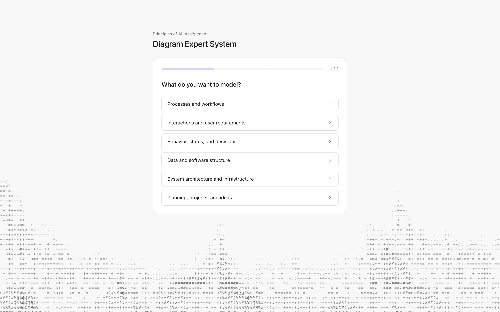
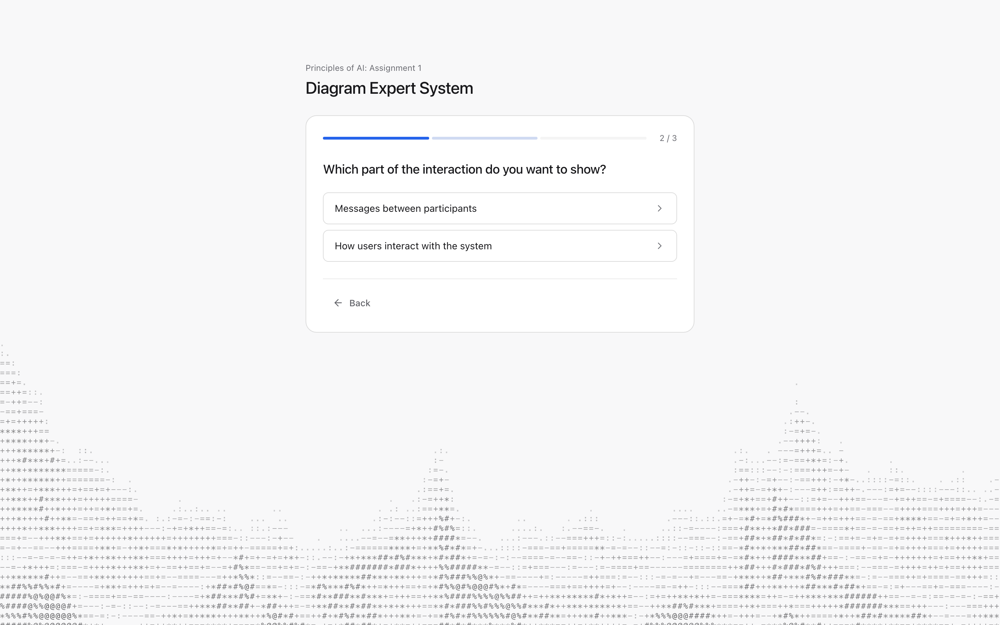
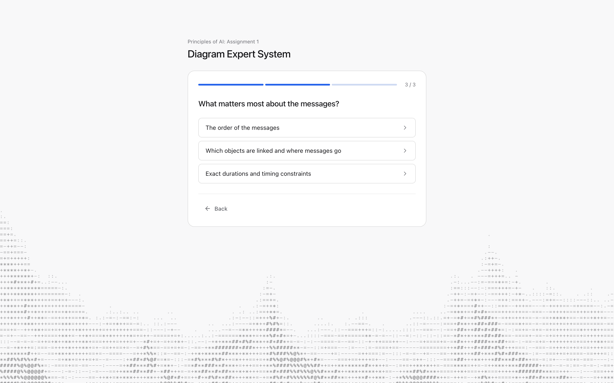
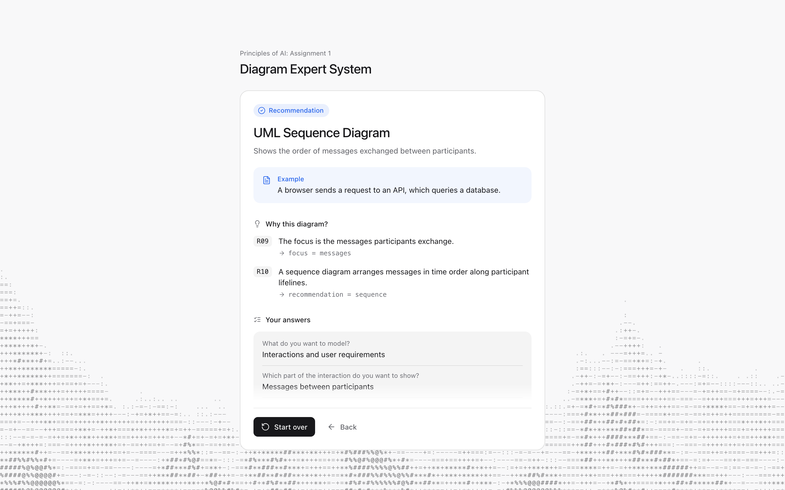

<h1 align="center">Diagram Expert System</h1>

<p align="center">
A rule-based expert system developed as Assignment 1 for the Principles of Artificial Intelligence course. It asks three questions about what you want to model and recommends the diagram that fits best, with the rules that led to the result, an example and related diagrams. The questionnaire and its forward-chaining inference engine are written in TypeScript and run entirely in the browser.
</p>

https://github.com/user-attachments/assets/6836e27e-57c9-468d-a2f7-9edca8027705

## Getting started

Install Node.js 22.16.0 or later, then run these commands from the project directory.

```sh
npm install
npm run dev
```

Open the local URL printed by Vite.

Run `npm test` to check the inference engine and all consultation paths. Run `npm run build` to check the TypeScript types and create the production bundle in `dist/`.

The demo GIF is recorded from the built app. Its panel and script are in `scripts/demo-gif/`. To record it again, install ffmpeg, run `npx playwright-core install chromium` once, then run `npm run gif`.

## How it works

Every consultation starts with the same goal question. Your answers determine which focus and detail questions come next.

1. **Goal:** choose what you want to model.
2. **Focus:** choose which part of the goal to show.
3. **Detail:** choose what the diagram should emphasize.

The engine starts with the answers as facts in working memory. It applies any rule whose conditions match those facts, then checks the rules again until a pass adds no facts. This process is called forward chaining.

- **Focus rules** use the first two answers to infer the focus, which determines the detail question.
- **Recommendation rules** use the inferred focus and the third answer to pick a diagram.

## Example

Suppose you want to show the order of messages between a browser, an API, and a database.

### 1. Choose a goal



Select **Interactions and user requirements**. The engine records the goal and moves on to the next question.

```text
goal = interaction
```

### 2. Narrow the focus



Select **Messages between participants**. Rule R09 uses your first two answers to infer the focus.

```text
R09
IF goal = interaction AND interactionFocus = messages
THEN focus = messages
```

Working memory now holds both answers and the inferred focus.

```text
goal = interaction
interactionFocus = messages
focus = messages
```

### 3. Choose a detail



Select **The order of the messages**. Rule R10 combines that answer with the inferred focus to recommend a diagram.

```text
R10
IF focus = messages AND messagesDetail = order
THEN recommendation = sequence
```

### Result



The system recommends a **UML Sequence Diagram** because it shows when each message is sent relative to the others.

The result shows an example, the facts inferred by R09 and R10, and the answers you selected. It also lists a UML Class Diagram and a UML Communication Diagram as related options.

Select **Back** to revisit your last answer or **Start over** to begin a new consultation.

## Questions and recommendations

The knowledge base contains 19 questions, 48 rules, and 28 diagram types. There are 36 possible paths through the questionnaire.

The first question is **What do you want to model?** Expand a goal below to see its follow-up questions and recommendations.

<details>
<summary><b>Processes and workflows</b></summary>

**Step 2:** What do you want to show about the process?

- Steps, decisions, and execution order
  - **Step 3:** What kind of workflow are you modeling?
    - An algorithm or simple procedure with decisions: **Flowchart**
    - A software workflow with parallel or synchronized tasks: **UML Activity Diagram**
    - A formal business process with events and messages: **BPMN Diagram**

- Who does what in the process
  - **Step 3:** What do you want to show about the participants?
    - Who performs each step: **Swimlane Diagram**
    - How participants in different organizations exchange messages: **BPMN Diagram**
    - What each actor can do in the system: **UML Use Case Diagram**

</details>

<details>
<summary><b>Interactions and user requirements</b></summary>

**Step 2:** Which part of the interaction do you want to show?

- Messages between participants
  - **Step 3:** What matters most about the messages?
    - The order of the messages: **UML Sequence Diagram**
    - Which objects are linked and where messages go: **UML Communication Diagram**
    - Exact durations and timing constraints: **UML Timing Diagram**

- How users interact with the system
  - **Step 3:** What do you want to show about users and the system?
    - What each actor can do in the system: **UML Use Case Diagram**
    - How users move between pages or screens: **User Flow Diagram**
    - The system boundary, its users, and external systems: **C4 System Context Diagram**

</details>

<details>
<summary><b>Behavior, states, and decisions</b></summary>

**Step 2:** What kind of behavior do you want to describe?

- The lifecycle of an entity or system
  - **Step 3:** What matters most about the lifecycle?
    - States and the events that trigger transitions: **UML State Machine Diagram**
    - When states change and how long they last: **UML Timing Diagram**
    - The flow of actions and branches: **UML Activity Diagram**

- How rules and conditions guide decisions
  - **Step 3:** How do conditions affect what happens next?
    - A hierarchy of conditions and outcomes: **Decision Tree**
    - Decisions determine the next step in a procedure: **Flowchart**
    - Events and conditions trigger state changes: **UML State Machine Diagram**

</details>

<details>
<summary><b>Data and software structure</b></summary>

**Step 2:** What kind of structure are you modeling?

- How data is organized or moves
  - **Step 3:** What do you need to show about the data?
    - Database entities, attributes, and relationships: **Entity-Relationship Diagram (ERD)**
    - Data moving between processes, stores, and external entities: **Data Flow Diagram (DFD)**
    - Nested data, such as a document structure: **Tree Diagram**

- Software classes, objects, and packages
  - **Step 3:** Which part of the software structure matters most?
    - Classes, attributes, methods, and relationships: **UML Class Diagram**
    - Specific objects and their links at one point in time: **UML Object Diagram**
    - Groups of related code and their dependencies: **UML Package Diagram**

</details>

<details>
<summary><b>System architecture and infrastructure</b></summary>

**Step 2:** Which part of the architecture are you describing?

- How the software is organized
  - **Step 3:** How much of the software structure do you want to show?
    - The whole system, its users, and external systems: **C4 System Context Diagram**
    - Applications, services, and data stores inside the system: **C4 Container Diagram**
    - Internal modules, components, and their interfaces: **UML Component Diagram**

- Where the software runs and how it communicates
  - **Step 3:** What do you need to show about the runtime environment?
    - Hosts and the software they run: **UML Deployment Diagram**
    - How network devices are connected and arranged: **Network Topology Diagram**
    - The order of requests between running services: **UML Sequence Diagram**

</details>

<details>
<summary><b>Planning, projects, and ideas</b></summary>

**Step 2:** What are you planning or organizing?

- A project and its tasks
  - **Step 3:** What do you need to show about the project?
    - Task start and end dates on a calendar: **Gantt Chart**
    - Task dependencies and possible paths through the project: **PERT Network Diagram**
    - How the project breaks down into deliverables: **Work Breakdown Structure (WBS)**

- Ideas, concepts, and organizational relationships
  - **Step 3:** What kind of relationships do you want to show?
    - Ideas branching from a central topic: **Mind Map**
    - Concepts linked by labels that explain their relationships: **Concept Map**
    - Teams and who reports to whom: **Organizational Chart**

</details>

## Inference rules

The engine uses 12 focus rules and 36 recommendation rules. Each row shows the exact conditions the engine checks and the fact it adds when they match.

### Processes and workflows

| Rule | IF | THEN | Diagram |
| --- | --- | --- | --- |
| R01 | `goal = process AND processFocus = control-flow` | `focus = control-flow` | |
| R02 | `focus = control-flow AND controlFlowDetail = algorithm` | `recommendation = flowchart` | Flowchart |
| R03 | `focus = control-flow AND controlFlowDetail = parallel` | `recommendation = activity` | UML Activity Diagram |
| R04 | `focus = control-flow AND controlFlowDetail = business` | `recommendation = bpmn` | BPMN Diagram |
| R05 | `goal = process AND processFocus = responsibility` | `focus = responsibility` | |
| R06 | `focus = responsibility AND responsibilityDetail = ownership` | `recommendation = swimlane` | Swimlane Diagram |
| R07 | `focus = responsibility AND responsibilityDetail = collaboration` | `recommendation = bpmn` | BPMN Diagram |
| R08 | `focus = responsibility AND responsibilityDetail = capabilities` | `recommendation = use-case` | UML Use Case Diagram |

### Interactions and user requirements

| Rule | IF | THEN | Diagram |
| --- | --- | --- | --- |
| R09 | `goal = interaction AND interactionFocus = messages` | `focus = messages` | |
| R10 | `focus = messages AND messagesDetail = order` | `recommendation = sequence` | UML Sequence Diagram |
| R11 | `focus = messages AND messagesDetail = links` | `recommendation = communication` | UML Communication Diagram |
| R12 | `focus = messages AND messagesDetail = time` | `recommendation = timing` | UML Timing Diagram |
| R13 | `goal = interaction AND interactionFocus = users` | `focus = users` | |
| R14 | `focus = users AND usersDetail = functions` | `recommendation = use-case` | UML Use Case Diagram |
| R15 | `focus = users AND usersDetail = navigation` | `recommendation = user-flow` | User Flow Diagram |
| R16 | `focus = users AND usersDetail = boundary` | `recommendation = system-context` | C4 System Context Diagram |

### Behavior, states, and decisions

| Rule | IF | THEN | Diagram |
| --- | --- | --- | --- |
| R17 | `goal = behavior AND behaviorFocus = lifecycle` | `focus = lifecycle` | |
| R18 | `focus = lifecycle AND lifecycleDetail = states` | `recommendation = state` | UML State Machine Diagram |
| R19 | `focus = lifecycle AND lifecycleDetail = durations` | `recommendation = timing` | UML Timing Diagram |
| R20 | `focus = lifecycle AND lifecycleDetail = activities` | `recommendation = activity` | UML Activity Diagram |
| R21 | `goal = behavior AND behaviorFocus = decisions` | `focus = decisions` | |
| R22 | `focus = decisions AND decisionsDetail = hierarchy` | `recommendation = decision-tree` | Decision Tree |
| R23 | `focus = decisions AND decisionsDetail = procedure` | `recommendation = flowchart` | Flowchart |
| R24 | `focus = decisions AND decisionsDetail = events` | `recommendation = state` | UML State Machine Diagram |

### Data and software structure

| Rule | IF | THEN | Diagram |
| --- | --- | --- | --- |
| R25 | `goal = structure AND structureFocus = data` | `focus = data` | |
| R26 | `focus = data AND dataDetail = database` | `recommendation = er` | Entity-Relationship Diagram (ERD) |
| R27 | `focus = data AND dataDetail = movement` | `recommendation = dfd` | Data Flow Diagram (DFD) |
| R28 | `focus = data AND dataDetail = hierarchy` | `recommendation = tree` | Tree Diagram |
| R29 | `goal = structure AND structureFocus = objects` | `focus = objects` | |
| R30 | `focus = objects AND objectsDetail = types` | `recommendation = class` | UML Class Diagram |
| R31 | `focus = objects AND objectsDetail = instances` | `recommendation = object` | UML Object Diagram |
| R32 | `focus = objects AND objectsDetail = packages` | `recommendation = package` | UML Package Diagram |

### System architecture and infrastructure

| Rule | IF | THEN | Diagram |
| --- | --- | --- | --- |
| R33 | `goal = architecture AND architectureFocus = software` | `focus = software` | |
| R34 | `focus = software AND softwareDetail = context` | `recommendation = system-context` | C4 System Context Diagram |
| R35 | `focus = software AND softwareDetail = containers` | `recommendation = container` | C4 Container Diagram |
| R36 | `focus = software AND softwareDetail = modules` | `recommendation = component` | UML Component Diagram |
| R37 | `goal = architecture AND architectureFocus = infrastructure` | `focus = infrastructure` | |
| R38 | `focus = infrastructure AND infrastructureDetail = hosting` | `recommendation = deployment` | UML Deployment Diagram |
| R39 | `focus = infrastructure AND infrastructureDetail = network` | `recommendation = network` | Network Topology Diagram |
| R40 | `focus = infrastructure AND infrastructureDetail = requests` | `recommendation = sequence` | UML Sequence Diagram |

### Planning, projects, and ideas

| Rule | IF | THEN | Diagram |
| --- | --- | --- | --- |
| R41 | `goal = planning AND planningFocus = project` | `focus = project` | |
| R42 | `focus = project AND projectDetail = schedule` | `recommendation = gantt` | Gantt Chart |
| R43 | `focus = project AND projectDetail = dependencies` | `recommendation = pert` | PERT Network Diagram |
| R44 | `focus = project AND projectDetail = scope` | `recommendation = wbs` | Work Breakdown Structure (WBS) |
| R45 | `goal = planning AND planningFocus = ideas` | `focus = ideas` | |
| R46 | `focus = ideas AND ideasDetail = brainstorm` | `recommendation = mind-map` | Mind Map |
| R47 | `focus = ideas AND ideasDetail = concepts` | `recommendation = concept-map` | Concept Map |
| R48 | `focus = ideas AND ideasDetail = reporting` | `recommendation = org-chart` | Organizational Chart |

## Limitations

Each consultation returns one recommendation from the rules in the knowledge base. The diagram catalog supplies the related suggestions for that recommendation.
